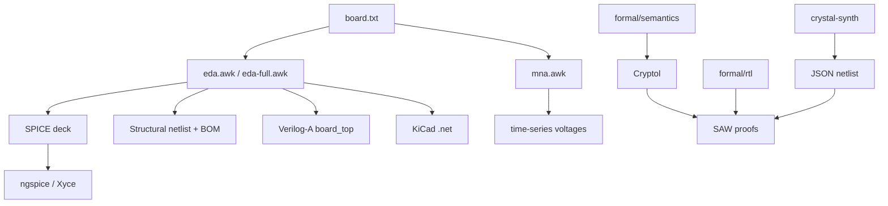

# Sovereign Circuits

**Zero-Dependency POSIX EDA and Formal Verification Stack for Safety-Critical Dual-Circuit Designs**

| Item | Value |
|------|-------|
| License | GNU Affero General Public License v3.0 |
| Status | Production Candidate |
| Core path dependencies | POSIX `awk` only |
| Formal stack | Cryptol, SAW, Z3, Why3-style `.mlw` |
| RTL | Pure IEEE 1076 VHDL (GHDL) |
| Analog | Verilog-A + SPICE parasitics |
| Synthesis assist | Crystal → VHDL + SAW JSON (no Yosys required for write-cell) |
| Primary safety object | Dual-oscillator phase controller gating SRAM writes |

---

## Table of Contents

1. [Introduction and Scope](#1-introduction-and-scope)
2. [Repository Layout and Configuration Items](#2-repository-layout-and-configuration-items)
3. [System Overview and Data Flow](#3-system-overview-and-data-flow)
4. [Board Description Language](#4-board-description-language)
5. [POSIX EDA Compiler Family](#5-posix-eda-compiler-family)
6. [Language Architecture](#6-language-architecture)
7. [Hardware Architecture — RTL, Analog, Interfaces](#7-hardware-architecture--rtl-analog-interfaces)
8. [Build System — Dependencies, Toolchains, Commands](#8-build-system--dependencies-toolchains-commands)
9. [Formal Verification — Proof Obligations, Assumptions, Evidence](#9-formal-verification--proof-obligations-assumptions-evidence)
10. [Simulation — SPICE, Verilog-A, VHDL Workflows](#10-simulation--spice-verilog-a-vhdl-workflows)
11. [Testing — Suites, Cases, Fixtures, Results](#11-testing--suites-cases-fixtures-results)
12. [Performance — Benchmarks, Timing, Resources](#12-performance--benchmarks-timing-resources)
13. [Safety and Reliability — Hazards, Failure Modes, Mitigation](#13-safety-and-reliability--hazards-failure-modes-mitigation)
14. [Security — Threat Model, Dependency Controls](#14-security--threat-model-dependency-controls)
15. [Traceability — Requirements-to-Evidence Mappings](#15-traceability--requirements-to-evidence-mappings)
16. [Integration — Interfaces, APIs, Interoperability](#16-integration--interfaces-apis-interoperability)
17. [Installation and Deployment](#17-installation-and-deployment)
18. [Operations — Troubleshooting, Recovery, Maintenance](#18-operations--troubleshooting-recovery-maintenance)
19. [Release Engineering — Versioning, Baselines, Criteria](#19-release-engineering--versioning-baselines-criteria)
20. [Technical References — Standards, Glossary, Publications](#20-technical-references--standards-glossary-publications)

---

## 1. Introduction and Scope

### 1.1 Purpose

Sovereign Circuits is a source-auditable toolchain and formal model suite for the design, analysis, and safety argumentation of mixed-signal dual-circuit systems. The primary system under analysis consists of a phase-error-driven controller, dual oscillators, a calibration word, and an SRAM bank whose write-enable is gated by controller lock status.

The software artifacts (POSIX EDA tools, formal models, RTL, analog models) are the deliverable. The dual-circuit is the object of the formal safety claims.

Design intent is *sovereignty*: every critical path can be inspected, rebuilt, and re-verified using only publicly available source tools and a standard POSIX environment. No proprietary EDA binary, no closed-source parser, and no network service is required for the core board-to-netlist, board-to-SPICE, or formal property discharge paths.

### 1.2 Primary System Under Analysis

```
                  ┌─────────────────────────────────────────────┐
                  │              dual_circuit                   │
                  │                                             │
  osc_clk_a ────►│  phase_calibrator  ──phase_err──► p4_controller
  osc_clk_b ────►│         │                         │         │
                  │         │                    locked         │
                  │         │                  sram_we_en       │
                  │         │                         │         │
  we_req ────────┼─────────┼─────────────────────────┤         │
  addr ──────────┼─────────┼─────────────────────────┤         │
  din ───────────┼─────────┼─────────────────────────┤         │
                  │         │                         ▼         │
                  │         │                    sram_bank      │
                  │         │                         │         │
  dout ◄─────────┼─────────┼─────────────────────────┘         │
  cal_word ◄─────┼─────────┘                                   │
  locked ◄───────┼─────────────────────────────────────────────┤
                  └─────────────────────────────────────────────┘
```

Controller modes: `Idle → Calibrate → Run | Fault`.  
SRAM write-enable is the logical AND of the external write request and the controller’s internal `sram_we_en`, asserted only when `mode = RUN` and `locked = true`.

### 1.3 Design Goals

1. **Zero-dependency core path.** Board compilation, ERC, multi-format emission, and MNA solution execute with only POSIX `awk`.
2. **Machine-checked safety properties.** Invariants relating mode, lock, and SRAM write enable are stated in Cryptol and discharged by SAW/Z3 (or as lemmas in the semantic models).
3. **Textual inspectability.** All intermediate artifacts are human-readable text.
4. **Separation of generation from verification.** The awk compilers do not embed formal claims; the formal models do not depend on any particular generated netlist format.
5. **Pure RTL.** VHDL is IEEE 1076, elaboratable by GHDL, free of vendor primitives.

### 1.4 Non-Goals and Explicit Limitations

- Continuous-time formal verification of the analog oscillators is out of scope; oscillators are abstracted to discrete phase-error and calibration-word interfaces.
- Device-level SPICE accuracy (BSIM, etc.) is not claimed; the pure-awk MNA uses idealized linear and Shockley diode models.
- Full automatic equivalence of the entire `p4_controller` RTL against Cryptol is prepared but requires a synthesized netlist (AIGER / Yosys or equivalent); the write-cell path has a complete Crystal-generated JSON equivalence path.
- Third-party tool versions (SAW, Z3, GHDL, ngspice) are recorded in release evidence; behavioral guarantees are limited to the versions used for a given baseline.

### 1.5 Audience and Reading Order

- **Developers** extending compilers or models: Chapters 4–7, 9, 16.
- **Reviewers of the safety case**: Chapters 9, 13, 15.
- **Release / configuration managers**: Chapters 8, 19, and `docs/08-configuration-management/`.
- **Operators / integrators**: Chapters 10, 17, 18.

Requirement IDs (`FR-*`), hazard IDs (`H-*`), and test-case IDs (`TC-*`) are stable and used for cross-reference. Process detail lives under `docs/`; this README is the technical spine.

---

## 2. Repository Layout and Configuration Items

### 2.1 Top-Level Structure

```
Sovereign-circuits/
├── LICENSE                          # AGPLv3 full text
├── README.md                        # This document
├── docs/                            # Process & assurance (12 areas)
│   ├── 01-requirements/SRS.md
│   ├── 02-architecture/Architecture.md
│   ├── 03-traceability/Traceability-Matrix.md
│   ├── 04-verification/Verification-Plan.md
│   ├── 05-validation/Validation-Plan.md
│   ├── 06-testing/Test-Strategy.md
│   ├── 07-safety/Safety-Analysis.md
│   ├── 08-configuration-management/CM-Plan.md
│   ├── 09-software-assurance/Assurance-Plan.md
│   ├── 10-cybersecurity/Cybersecurity.md
│   ├── 11-operations/Operations.md
│   ├── 12-release/Release-Process.md
│   └── README.md
├── posix-eda/                       # Zero-dep board tools
│   ├── board.txt                    # RC + diode example
│   ├── board-hybrid.txt             # RC + inline .va example
│   ├── eda.awk                      # Basic spice/netlist
│   ├── eda-full.awk                 # spice|veriloga|netlist|kicad
│   └── mna.awk                      # DC + transient MNA + diode
├── formal/
│   ├── semantics/                   # Why3-style models
│   │   ├── state.mlw
│   │   ├── sram.mlw
│   │   ├── oscillator.mlw
│   │   ├── refinement.mlw
│   │   └── sram_write_cell.mlw
│   ├── cryptol/                     # Executable specs + properties
│   │   ├── state.cry
│   │   ├── sram.cry
│   │   ├── circuit_contract.cry
│   │   ├── sram_write_cell.cry
│   │   ├── malbolge_alu.cry
│   │   └── p4_dual_circuit.cry
│   ├── saw/                         # Proof scripts
│   │   ├── digital_equivalence.saw
│   │   ├── sram_refinement.saw
│   │   ├── proof_gate.saw
│   │   └── verify_all.saw
│   ├── rtl/                         # Pure VHDL
│   │   ├── p4_controller.vhd
│   │   ├── dual_circuit.vhd
│   │   ├── sram_bank.vhd
│   │   ├── phase_calibrator.vhd
│   │   └── sram_write_cell.vhd
│   ├── analog/
│   │   ├── oscillator.va
│   │   ├── relaxation.va
│   │   └── parasitic_model.sp
│   └── verification/
│       ├── psl/dual_circuit.psl
│       ├── pex/pex_rc_check.awk
│       └── thermal/thermal_sweep.sp
├── crystal-synth/
│   └── synth_sram.cr                # Zero-Yosys VHDL + JSON
├── tests/                           # Test scaffolding
└── scripts/
    └── run-proofs.sh
```

### 2.2 Configuration Item Classification

| CI Class | Paths | Control Level |
|----------|-------|---------------|
| Core generators | `posix-eda/*.awk` | Baseline + peer review |
| Formal models | `formal/semantics/`, `formal/cryptol/` | Baseline + proof re-run on change |
| Proof scripts | `formal/saw/` | Baseline + proof re-run |
| RTL | `formal/rtl/` | Baseline + GHDL elaborate + review |
| Analog models | `formal/analog/` | Baseline + inspection |
| Process docs | `docs/` | Baseline |
| Examples | `posix-eda/board*.txt` | Baseline |

### 2.3 Stable Identifiers

- Requirements: `FR-01` … `FR-10`, `NFR-01` … `NFR-04` (see `docs/01-requirements/SRS.md`)
- Hazards: `H-01` … `H-05` (see Chapter 13 and `docs/07-safety/`)
- Safety requirements derived: `SR-01` … `SR-03`
- Test cases: `TC-EDA-*`, `TC-ERC-*`, `TC-MNA-*`, `TC-FORMAL-*`, `TC-RTL-*`
- Proof obligations: `PO-01` … `PO-09`

---

## 3. System Overview and Data Flow

### 3.1 End-to-End Pipeline



### 3.2 Safety-Critical Data Path

```
phase_err (signed 8-bit)
        │
        ▼
┌───────────────────┐
│   p4_controller   │
│  mode, locked,    │
│  cal_word,        │
│  sram_we_en       │
└─────────┬─────────┘
          │ sram_we_en = (mode==RUN) ∧ locked
          ▼
┌───────────────────┐
│ we_req ∧ sram_we_en│
└─────────┬─────────┘
          ▼
      sram_bank
```

**Contract (SR-01 / FR-07):**  
`sram_we_en = 1` only if `mode_out = "10"` (RUN) and `locked = '1'`.

This contract is stated in Cryptol (`circuit_contract.cry`), implemented in VHDL (`p4_controller.vhd`), and proved in SAW (`sram_write_protected`).

### 3.3 Global Assumptions

1. Ground reference is node `0` or `gnd`.
2. Reference designators begin with R, C, L, V, I, D, or X.
3. Phase error is a signed 8-bit quantity in the range [−128, 127].
4. Calibration word is an 8-bit quantity in the range [0, 255].
5. Formal models abstract continuous-time oscillator dynamics into discrete phase-error samples and a calibration word.
6. The refinement relation between abstract state and RTL is maintained by construction from the same state diagram; full automatic equivalence of the controller requires a gate-level netlist.

### 3.4 Data Flow for Formal Safety Case

```
phase_err ──► State.step ──► mode, locked, cal_word
                    │
                    ▼
            sram_access_safe(we)  =  we → (mode = Run ∧ locked)
                    │
                    ▼
            SRAM.cycle only when gated
```

---

## 4. Board Description Language

### 4.1 Syntax Rules

- One component or directive per line.
- Whitespace-delimited fields.
- Comments begin with `#` or `*`.
- Blank lines ignored.
- Nets are case-insensitive; `gnd` normalized to `0`.

### 4.2 Component Form

```
<REFDES> <NET1> <NET2> [NET3 ...] <VALUE_OR_MODEL> [PARAM=VAL ...]
```

**Type inference** by first letter of REFDES:

| Letter | Type | Ports | Value meaning |
|--------|------|-------|---------------|
| R | Resistor | 2 | Resistance |
| C | Capacitor | 2 | Capacitance |
| L | Inductor | 2 | Inductance |
| V | Voltage source | 2 | DC value or SIN(...) |
| I | Current source | 2 | DC value |
| D | Diode | 2 | Model name |
| X | Subcircuit / behavioral | ≥2 | Model name + parameters |

### 4.3 Golden Example — RC + Diode

**File:** `posix-eda/board.txt`

```
# RC Low-Pass Filter + Diode Clipper
V1   in   0     SIN(0 5 1k)
R1   in   out   1k
C1   out  0     100n
D1   out  0     DMOD

.model DMOD D(IS=1e-14 N=1)
.tran 10u 5m
```

### 4.4 Hybrid Example — Inline Verilog-A

**File:** `posix-eda/board-hybrid.txt`

```
# Hybrid Analog Board: RC Filter + Behavioral Nonlinear Memristive Load
V1   in   0     5.0
R1   in   out   1k
C1   out  0     100n
X1   out  0     soft_clipper  R0=2k  Vth=1.2

.va soft_clipper p n R0=1k Vth=0.7
    I(p, n) <+ (V(p, n) / R0) + 1e-6 * sinh(V(p, n) / Vth);
.endva

.tran 10u 5m
```

### 4.5 SI Suffix Table

| Suffix | Multiplier | Example |
|--------|------------|---------|
| T / t | 1e12 | 1t |
| G / g | 1e9 | 1g |
| MEG / meg | 1e6 | 1meg |
| K / k | 1e3 | 1k |
| (none) | 1 | 100 |
| M / m | 1e-3 | 1m |
| U / u | 1e-6 | 1u |
| N / n | 1e-9 | 100n |
| P / p | 1e-12 | 1p |
| F / f | 1e-15 | 45f |

Recognized by both `eda-full.awk` (`si_to_real`) and `mna.awk` (`si`).

### 4.6 Supported Directives

- `.model ...` — passed through in SPICE mode
- `.tran <tstep> <tstop>` — consumed by `mna.awk`; passed through by eda
- `.subckt` / `.ends` — captured and re-emitted in SPICE mode
- `.va` / `.endva` — captured for Verilog-A synthesis in `eda-full.awk`

---

## 5. POSIX EDA Compiler Family

### 5.1 eda.awk — Basic Compiler

**File:** `posix-eda/eda.awk`  
**Invocation:** `awk -v mode=spice|netlist -f posix-eda/eda.awk <board>`

**Processing pipeline:**
1. Strip `#` comments and leading/trailing whitespace.
2. Skip blank lines and `*` comments.
3. Capture `.` directives into `directives[]`.
4. Parse component lines: ref = $1, value = $NF, nets = fields 2..NF-1.
5. Normalize `gnd` → `0`.
6. Accumulate `net_deg` and `net_pins`.
7. END: emit ERC warnings for floating nets; emit SPICE or netlist.

**ERC rule (floating):**  
`if (n != "0" && net_deg[n] < 2) WARNING`

### 5.2 eda-full.awk — Extended Compiler

**File:** `posix-eda/eda-full.awk`  
**Modes:** `spice | veriloga | netlist | kicad`

**Additional functions:**
- `si_to_real(s)` — suffix conversion
- `norm_net(n)` — gnd/0 normalization
- `add_net(n, ref, pin_idx)` — net registry
- Capture of `.va` ... `.endva` bodies
- Capture of `.subckt` ... `.ends`
- Parameter splitting for trailing `KEY=VAL`
- BOM aggregation by `type|value`
- Duplicate reference detection

**Verilog-A synthesis (mode=veriloga):**
1. Emit user-defined modules from captured `.va` bodies.
2. Emit `board_top` with electrical nodes and analog contributions:
   - R → `I(n1,n2) <+ V(n1,n2)/R`
   - C → `I(n1,n2) <+ C * ddt(V(n1,n2))`
   - L → `V(n1,n2) <+ L * ddt(I(n1,n2))`
   - V → `V(n1,n2) <+ value`
   - I → `I(n1,n2) <+ value`
   - X → structural instantiation with parameter overrides

### 5.3 mna.awk — Modified Nodal Analysis Solver

**File:** `posix-eda/mna.awk`

**Supported devices:** R, C, L, V (DC or SIN), I, D (Shockley).

**MNA formulation (core):**

For a resistor between n1 and n2 with conductance g = 1/R:
```
A[n1,n1] += g;  A[n2,n2] += g
A[n1,n2] -= g;  A[n2,n1] -= g
```

For a capacitor (Backward-Euler, time step dt):
```
g = C / dt
ieq = g * Vprev
stamp resistor g;  b[n1] += ieq;  b[n2] -= ieq
```

For a diode (Shockley, Is=1e-14, Vt=0.02585):
```
if vd > 0.8:
  gd = (Is/Vt)*exp(0.8/Vt)
  id = Is*(exp(0.8/Vt)-1) + gd*(vd-0.8)
else if vd < -5:
  gd = 1e-12; id = -Is + gd*vd
else:
  e = exp(vd/Vt)
  gd = (Is/Vt)*e + 1e-12
  id = Is*(e-1)
ieq = id - gd*vd
stamp gd; b[n1] -= ieq; b[n2] += ieq
```

Newton-Raphson (max 20 iterations) when diodes present; convergence threshold 1e-9.

**Linear solve:** Gaussian elimination with partial pivoting; singular matrix → explicit error and exit 1.

**Output:**  
```
time    v(net1)  v(net2)  ...
0.000e+00  ...
```

### 5.4 Commands and Expected Results

```bash
# SPICE
awk -v mode=spice -f posix-eda/eda.awk posix-eda/board.txt
# Expected: * Generated by eda.awk ... .end

# Netlist + ERC
awk -v mode=netlist -f posix-eda/eda-full.awk posix-eda/board.txt
# Expected: COMPONENTS / NETS (DEGREE : PINS) / BOM sections

# MNA
awk -f posix-eda/mna.awk posix-eda/board.txt | column -t
# Expected: time-series header + numeric rows
```

---

## 6. Language Architecture

### 6.1 Board Language Role

The board description is a minimal domain-specific intermediate. It is not a full HDL. It exists to be transformed, by pure text tools, into SPICE, structural netlists, Verilog-A, or KiCad S-expressions without requiring a binary frontend.

### 6.2 Semantic Layer (Why3-style `.mlw`)

**Directory:** `formal/semantics/`

#### 6.2.1 State Machine (`state.mlw`)

```
type mode = Idle | Calibrate | Run | Fault

type t = {
  mode : mode;
  phase_err : int;
  cal_word : int;
  locked : bool;
}

predicate inv (s: t) =
  0 <= s.cal_word <= 255 /\
  -128 <= s.phase_err <= 127 /\
  (s.mode = Run -> s.locked = true) /\
  (s.mode = Fault -> s.locked = false)
```

**Step function (simplified):**
- Fault is absorbing.
- Out-of-range phase_err → Fault.
- Idle + start → Calibrate.
- Calibrate + |err| ≤ 2 → Run (locked).
- Calibrate + err > 0 → decrement cal_word (floor 0).
- Calibrate + err < 0 → increment cal_word (ceil 255).
- Run + |err| ≤ 4 → stay Run (locked).
- Run + |err| > 4 → Calibrate (unlocked).

**Lemma:** `step_preserves_inv`

#### 6.2.2 SRAM (`sram.mlw`)

```
constant depth : int = 256
type mem = map int int

function cycle (m: t) (we: bool) (a: int) (v: int) : t
  requires { valid_addr a /\ 0 <= v < 4294967296 }
= ...
lemma write_then_read :
  forall m a v. valid_addr a -> 0 <= v < 2^32 ->
    (cycle m true a v).dout = v
```

#### 6.2.3 Oscillator (`oscillator.mlw`)

```
function nominal_period (cal: int) : int =
  10000 - (cal - 128) * 30

lemma nominal_period_bounds :
  forall cal. 0 <= cal <= 255 -> 1000 <= nominal_period cal <= 20000
```

#### 6.2.4 Refinement (`refinement.mlw`)

```
predicate sys_inv (sys: system) =
  State.inv sys.ctrl /\
  SRAM.inv sys.mem /\
  Oscillator.inv sys.osc /\
  sys.osc.cal_code = sys.ctrl.cal_word

predicate sram_access_safe (sys: system) (we: bool) =
  we -> (sys.ctrl.mode = State.Run /\ sys.ctrl.locked = true)
```

### 6.3 Cryptol Layer

**Directory:** `formal/cryptol/`

Cryptol supplies bit-precise executable models and the properties that SAW discharges.

| Module | File | Key Properties |
|--------|------|----------------|
| State | `state.cry` | `run_implies_locked` |
| SRAM | `sram.cry` | `write_read_match` |
| Circuit contract | `circuit_contract.cry` | `sram_write_protected` |
| Write cell | `sram_write_cell.cry` | `writeRetainsWhenDisabled`, `bitlinesComplementaryWhenEnabled` |
| P4 dual | `p4_dual_circuit.cry` | `runImpliesNotLocked` |
| Malbolge ALU | `malbolge_alu.cry` | `addSubInverse`, `crazySelfBound` |

**Controller property (state.cry):**
```
property run_implies_locked s start err =
    (s'.mode == RUN) ==> s'.locked
    where s' = step_state s start err
```

**Write protection (circuit_contract.cry):**
```
property sram_write_protected dc start err we_req addr din =
    (ctrl'.mode != RUN) ==> 
      ((dual_step dc start err we_req addr din).sram.mem == dc.sram.mem)
    where ctrl' = step_state dc.ctrl start err
```

**Write-cell (sram_write_cell.cry):**
```
writeCell we din q_in =
  { q    = if we then din else q_in
  , bl   = din && we
  , bl_b = ~din && we
  }
```

### 6.4 Layer Relationship

```
.mlw  (abstract invariants & lemmas)
  │
  ▼
.cry  (bit-precise executable specs + properties)
  │
  ▼
.saw  (proof scripts discharging properties; optional RTL equivalence)
  │
  ▼
.vhd  (synthesizable implementation)
```

---

## 7. Hardware Architecture — RTL, Analog, Interfaces

### 7.1 RTL Entity Summary

**Directory:** `formal/rtl/`

| Entity | File | Responsibility |
|--------|------|----------------|
| `p4_controller` | `p4_controller.vhd` | Mode FSM, lock, cal_word, sram_we_en |
| `phase_calibrator` | `phase_calibrator.vhd` | Dual-clock edge phase error accumulator |
| `sram_bank` | `sram_bank.vhd` | 256×32 synchronous RAM |
| `sram_write_cell` | `sram_write_cell.vhd` | Bit write cell + complementary bitlines |
| `dual_circuit` | `dual_circuit.vhd` | Structural top-level |

### 7.2 Controller Mode Encoding and Lock Rule

| mode_out | Meaning |
|----------|---------|
| `"00"` | IDLE |
| `"01"` | CALIBRATE |
| `"10"` | RUN |
| `"11"` | FAULT |

**Implemented lock rule (`p4_controller.vhd`):**
```vhdl
sram_we_en <= '1' when (mode_reg = MODE_RUN and lock_reg = '1') else '0';
```

**Calibration update (CALIBRATE):**
- `err_abs <= 2` → enter RUN, set locked.
- else if `phase_err > 0` → decrement cal_reg (floor 0).
- else → increment cal_reg (ceil 255).

### 7.3 Phase Calibrator

Synchronizes `osc_clk_a` and `osc_clk_b` with 2-flop synchronizers. On rising edge of A without concurrent rising edge of B, increments saturated signed error; symmetric for B. Output range [−128, +127].

### 7.4 SRAM Bank

```vhdl
type ram_t is array (0 to 255) of std_logic_vector(31 downto 0);
-- synchronous write-through on we='1'; read otherwise
```

### 7.5 Write Cell

```vhdl
q    <= din when we = '1' else q_in;
bl   <= din and we;
bl_b <= (not din) and we;
```

### 7.6 Analog Models

**Directory:** `formal/analog/`

- `oscillator.va` — frequency = f0 + kvco*(Vctrl−0.9), clamped, idtmod phase, transition edges.
- `relaxation.va` — capacitor integration with hysteresis thresholds v_hi / v_lo and discharge resistor.
- `parasitic_model.sp` — `dual_interconnect` and `sram_bitline` RC + coupling.

### 7.7 Interface Contracts (Summary)

| Interface | Contract |
|-----------|----------|
| phase_err | signed(7 downto 0), saturated |
| cal_word | unsigned(7 downto 0) |
| sram_we_en | '1' only in RUN ∧ locked |
| write-cell q | retains when we='0'; follows din when we='1' |
| bitlines | complementary when we='1' |

---

## 8. Build System — Dependencies, Toolchains, Commands

### 8.1 Core Path (Zero Dependency)

```bash
awk -v mode=spice -f posix-eda/eda.awk posix-eda/board.txt
awk -v mode=netlist -f posix-eda/eda-full.awk posix-eda/board.txt
awk -f posix-eda/mna.awk posix-eda/board.txt
```

Requires only a POSIX-compatible `awk`. No other tools.

### 8.2 Optional Toolchain Matrix

| Tool | Purpose | Required for core safety claims? |
|------|---------|----------------------------------|
| ngspice / Xyce | SPICE simulation | No |
| GHDL | VHDL analysis / elaboration | No |
| SAW + Z3 | Formal proofs | Yes, for machine-checked evidence |
| Cryptol | Spec execution | Supporting |
| Crystal | Zero-Yosys write-cell JSON | Supporting (write-cell equivalence path) |
| OpenVAF | Verilog-A compilation | No |

### 8.3 Recommended Verification Sequence

```bash
# Structural + ERC
awk -v mode=netlist -f posix-eda/eda-full.awk posix-eda/board.txt

# MNA
awk -f posix-eda/mna.awk posix-eda/board.txt | head -20

# Crystal write-cell
cd crystal-synth && crystal run synth_sram.cr

# GHDL (optional)
ghdl -a --std=08 formal/rtl/*.vhd
ghdl -e --std=08 dual_circuit

# SAW proofs (optional but required for evidence)
saw formal/saw/proof_gate.saw
saw formal/saw/verify_all.saw
```

### 8.4 Expected Results (Representative)

- Golden boards produce well-formed SPICE decks ending in `.end` and netlists with COMPONENTS / NETS / BOM sections.
- `mna.awk` emits a `time` header followed by numeric rows; for the RC+diode board the output is attenuated and shows clipping consistent with diode orientation.
- Crystal emits `sram_write_cell.vhd` and `sram_write_cell.json`.
- GHDL analysis and elaboration complete without errors on the supplied RTL.
- SAW scripts discharge the stated properties when run with a compatible SAW/Z3 installation.

### 8.5 Reproducibility Notes

Core awk tools are deterministic pure functions of their text input. Formal proof results depend on SAW and Z3 versions; those versions must be recorded in release evidence for a baseline to be reproducible.

---

## 9. Formal Verification — Proof Obligations, Assumptions, Evidence

### 9.1 Proof Obligation Table

| ID | Property | Artifact | Status |
|----|----------|----------|--------|
| PO-01 | `run_implies_locked` | `state.cry` + SAW | Machine-checked when discharged |
| PO-02 | `sram_write_protected` | `circuit_contract.cry` + SAW | Machine-checked when discharged |
| PO-03 | `writeRetainsWhenDisabled` | `sram_write_cell.cry` | Machine-checked when discharged |
| PO-04 | `bitlinesComplementaryWhenEnabled` | `sram_write_cell.cry` | Machine-checked when discharged |
| PO-05 | Write-cell Cryptol ≡ Crystal JSON | `verify_all.saw` | Equivalence path present |
| PO-06 | `write_then_read` | `sram.mlw` | Lemma |
| PO-07 | `step_preserves_inv` | `state.mlw` | Lemma |
| PO-08 | `lock_implies_calibrated_osc` | `refinement.mlw` | Lemma |
| PO-09 | PSL mode/lock assertions | `dual_circuit.psl` | Assertion set |

### 9.2 Assumptions

1. Phase error remains in signed 8-bit range or the model transitions to Fault.
2. Abstract state machine and RTL share the same mode diagram; full automatic controller equivalence requires a gate-level netlist.
3. SRAM address/data widths match the models (8-bit address, 32-bit word for structural SRAM; bit-level write-cell is separate).
4. Crystal-generated JSON faithfully reflects the VHDL emitted by the same synthesizer.

### 9.3 Proven vs. Not Proven

**Proven (when SAW proofs discharge):**
- Controller cannot be in RUN without locked (PO-01).
- SRAM content unchanged by write request when not in RUN (PO-02).
- Write-cell retain and complementary bitlines (PO-03, PO-04).
- Semantic lemmas on invariants and oscillator bounds (PO-06–PO-08).

**Not claimed as machine-checked in current baseline:**
- Full RTL ↔ Cryptol equivalence of `p4_controller`.
- Continuous-time correctness of Verilog-A oscillators.
- Device-level numerical accuracy of `mna.awk` against a specific ngspice model card.

### 9.4 Evidence Artifacts

- `formal/saw/*.saw`
- `formal/cryptol/*.cry`
- `formal/semantics/*.mlw`
- `formal/verification/psl/dual_circuit.psl`

Successful SAW run logs should be archived under `docs/04-verification/evidence/` per release baseline.

---

## 10. Simulation — SPICE, Verilog-A, VHDL Workflows

### 10.1 SPICE

```bash
awk -v mode=spice -f posix-eda/eda.awk posix-eda/board.txt | ngspice -b -
```

Golden board is RC low-pass + diode to ground. Qualitative expectation: attenuated sinusoid with positive-side clipping.

### 10.2 Pure-Awk MNA

```bash
awk -f posix-eda/mna.awk posix-eda/board.txt | column -t
```

Useful when ngspice is unavailable or for solver regression.

### 10.3 Verilog-A

```bash
awk -v mode=veriloga -f posix-eda/eda-full.awk posix-eda/board-hybrid.txt > board.va
# optional: openvaf board.va
```

### 10.4 VHDL

```bash
ghdl -a --std=08 formal/rtl/*.vhd
ghdl -e --std=08 dual_circuit
```

### 10.5 Parasitic / Thermal

```bash
awk -f formal/verification/pex/pex_rc_check.awk formal/analog/parasitic_model.sp
```

Thermal deck: `formal/verification/thermal/thermal_sweep.sp`.

---

## 11. Testing — Suites, Cases, Fixtures, Results

### 11.1 Levels

| Level | Location | Focus |
|-------|----------|-------|
| Unit | `tests/unit/`, Cryptol properties | Functions and properties |
| Integration | `tests/integration/` | Board → tool → artifact |
| System | `tests/system/`, `verify_all.saw` | Dual-circuit + proofs |
| Regression | `tests/regression/` | Golden boards |
| Boundary | `tests/boundary/` | Floating nets, extremes |
| Acceptance | `tests/acceptance/` | Operational scenarios |

### 11.2 Representative Cases

| ID | Description | Expected |
|----|-------------|----------|
| TC-EDA-01 | Compile `board.txt` to SPICE | Well-formed deck |
| TC-ERC-01 | Floating net board | ERC WARNING |
| TC-MNA-01 | MNA on `board.txt` | Time-series, attenuated/clipped |
| TC-FORMAL-01 | `run_implies_locked` | Proof succeeds |
| TC-FORMAL-02 | `sram_write_protected` | Proof succeeds |
| TC-WRITE-CELL-01 | Write-cell equivalence | Proof succeeds |
| TC-RTL-01 | GHDL elaborate | Clean |

### 11.3 Fixtures

- `posix-eda/board.txt`, `posix-eda/board-hybrid.txt`
- `formal/saw/proof_gate.saw`, `formal/saw/verify_all.saw`

---

## 12. Performance — Benchmarks, Timing, Resources

### 12.1 Core Path

- `eda*.awk`: linear in components/nets; hundreds of components practical.
- `mna.awk`: O(N³) per time step (N = nodes + voltage-source branches). Intended for small-to-medium circuits.

### 12.2 Formal Proofs

Properties are small (bit-level or compact state machines). Expected to discharge in seconds on contemporary hardware with SAW/Z3.

### 12.3 Non-Claims

No real-time guarantees for MNA. No claims about place-and-route or timing closure of VHDL on any specific technology.

---

## 13. Safety and Reliability — Hazards, Failure Modes, Mitigation

### 13.1 Hazard Log

| ID | Description | Severity | Control |
|----|-------------|----------|---------|
| H-01 | Unauthorized SRAM write while unlocked | High | Gate + PO-02 |
| H-02 | RUN without locked | High | PO-01 + PSL |
| H-03 | Calibration out of bounds while locked | Medium | PO-08 |
| H-04 | Incorrect netlist → wrong conclusions | Medium | ERC + regression |
| H-05 | Proof for model that diverges from RTL | High | Equivalence strategy |

### 13.2 Derived Safety Requirements

- **SR-01:** SRAM WE only when RUN ∧ locked. (FR-07, PO-02)
- **SR-02:** Never enter RUN without locked. (FR-06, PO-01)
- **SR-03:** Models used for claims shown equivalent/refined to delivered RTL. (PO-05 + planned)

### 13.3 Software Failure Modes

| Failure | Detection | Reaction |
|---------|-----------|----------|
| Singular matrix | `solve_linear` | Error, exit 1 |
| Floating net | Degree count | WARNING stderr |
| Proof failure | SAW/Z3 | Release gate fails |
| Missing ground | Net presence | WARNING stderr |

### 13.4 Reliability

Core tools are pure functions of text input. No persistent state. Recovery is always re-run from clean source.

---

## 14. Security — Threat Model, Dependency Controls

### 14.1 Threat Summary

| Threat | Mitigation |
|--------|------------|
| Compromised binary EDA | Core path = source awk only |
| Tampering with models/proofs | Git history, tags, review, reproducible proofs |
| Malicious board text | Simple grammar; no command execution from board content |
| Vulnerable dependencies | Core has zero language deps; optional tools version-pinned |
| Unauthorized SRAM write | Primary safety property (H-01/SR-01), formally proved |

### 14.2 Dependency Posture

Core: POSIX awk only.  
Extended: Crystal, SAW, Z3, GHDL, ngspice, OpenVAF — versions recorded per release.

### 14.3 Access

Write access limited to maintainers. Consumers pin to tag or SHA. AGPLv3 preserves source availability for network use.

---

## 15. Traceability — Requirements-to-Evidence Mappings

Full matrix in `docs/03-traceability/Traceability-Matrix.md`.

| Req | Implementation | Evidence |
|-----|----------------|----------|
| FR-01 | `eda.awk`, `eda-full.awk` | SPICE emission |
| FR-02 | `eda-full.awk` netlist | Netlist + BOM |
| FR-03 | `eda-full.awk` veriloga | Generated `.va` |
| FR-04 | both eda*.awk | ERC warnings |
| FR-05 | `mna.awk` | Time-series |
| FR-06 | `state.cry`, `state.mlw` | PO-01 |
| FR-07 | `circuit_contract.cry`, `p4_controller.vhd` | PO-02 |
| FR-08 | `refinement.mlw`, `oscillator.mlw` | PO-08 |
| FR-09 | `sram_write_cell.cry` + RTL + Crystal | PO-03/04/05 |
| FR-10 | all `posix-eda/*.awk` | awk-only execution |

---

## 16. Integration — Interfaces, APIs, Interoperability

### 16.1 Text Interfaces

- Board → tools via stdin/file; artifacts on stdout.
- SPICE: standard deck.
- Netlist: `NET : pins` or KiCad S-expression.
- Verilog-A: modules + `board_top`.
- SAW: Cryptol + JSON via `yosys_import` schema.

### 16.2 No Binary API

No shared library, socket, or FFI in the core path. Integration is process composition and files.

### 16.3 Notes

SPICE emission is conservative. VHDL is pure IEEE. Crystal JSON matches SAW expectations.

---

## 17. Installation and Deployment

### 17.1 Core

```bash
git clone https://github.com/AHMADALIPARR/Sovereign-circuits.git
cd Sovereign-circuits
awk -f posix-eda/eda.awk posix-eda/board.txt | head
```

### 17.2 Optional Tools

Install per upstream docs: SAW+Cryptol+Z3, GHDL, ngspice, Crystal, OpenVAF.

### 17.3 Assumptions

POSIX shell/utilities. C/POSIX locale recommended for numeric scripts.

---

## 18. Operations — Troubleshooting, Recovery, Maintenance

### 18.1 Common Anomalies

| Symptom | Cause | Action |
|---------|-------|--------|
| ERC WARNING floating | Unconnected pin | Fix board or intentional tie |
| MNA singular | Missing ground / floating source | Add ground |
| SAW proof failure | Model/property change | Investigate; no verified claim until re-discharged |
| GHDL error | Syntax / missing entity | Check IEEE 1076 and order |

### 18.2 Recovery

```bash
git checkout <known-good-tag>
```

### 18.3 Maintenance

Formal/RTL changes require re-proof. Parser changes require golden regression. Docs update in same change set when requirements or architecture change.

---

## 19. Release Engineering — Versioning, Baselines, Criteria

### 19.1 Versioning

Semantic: `MAJOR.MINOR.PATCH`. Proof status recorded in notes.

### 19.2 Release Criteria

- [ ] All FR-* have evidence
- [ ] FR-06–09 discharged or explicitly deferred
- [ ] Golden regression + ERC pass
- [ ] Peer review complete
- [ ] Documentation updated
- [ ] Known issues current
- [ ] License intact

### 19.3 Artifacts

Source tag, release notes, verification summary, traceability status, residual-risk statement.

### 19.4 Revision History

| Commit / Tag | Description |
|--------------|-------------|
| Initial extraction | Technical content from source |
| Production organization | `docs/` process tree |
| Expanded README | 20-chapter technical documentation |
| (subsequent) | Git history + GitHub Releases |

Consumers record exact tag or SHA accepted for use.

---

## 20. Technical References — Standards, Glossary, Publications

### 20.1 Standards

- IEEE 1076 (VHDL)
- SPICE deck conventions (common subset)
- Cryptol language
- SAW documentation
- GNU AGPLv3

### 20.2 Glossary

| Term | Meaning |
|------|---------|
| ERC | Electrical Rule Check |
| MNA | Modified Nodal Analysis |
| PO | Proof Obligation |
| SR | Safety Requirement (derived) |
| FR | Functional Requirement |
| Zero-dependency core | Path requiring only POSIX awk |
| Locked | Controller bit indicating calibration success and RUN permission |

### 20.3 Internal References

- `docs/01-requirements/SRS.md`
- `docs/02-architecture/Architecture.md`
- `docs/03-traceability/Traceability-Matrix.md`
- `docs/07-safety/Safety-Analysis.md`
- `docs/12-release/Release-Process.md`

### 20.4 Provenance

Extracted and organized from a zero-dependency POSIX EDA + formal dual-circuit verification design. Authoritative implementation artifacts live under `posix-eda/`, `formal/`, and `crystal-synth/`. Process documentation under `docs/` supplies the assurance framework.

---

*End of technical README. Process-area detail is under `docs/`.*
